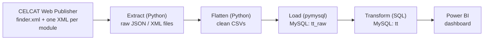
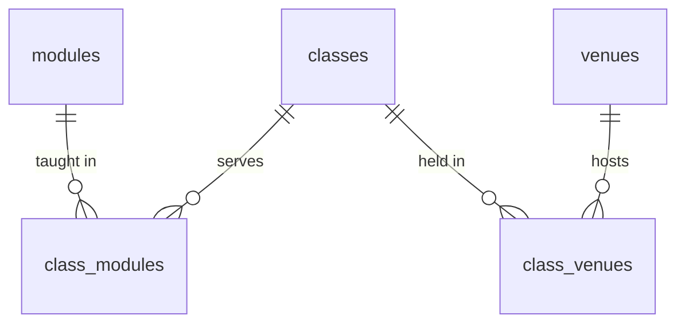
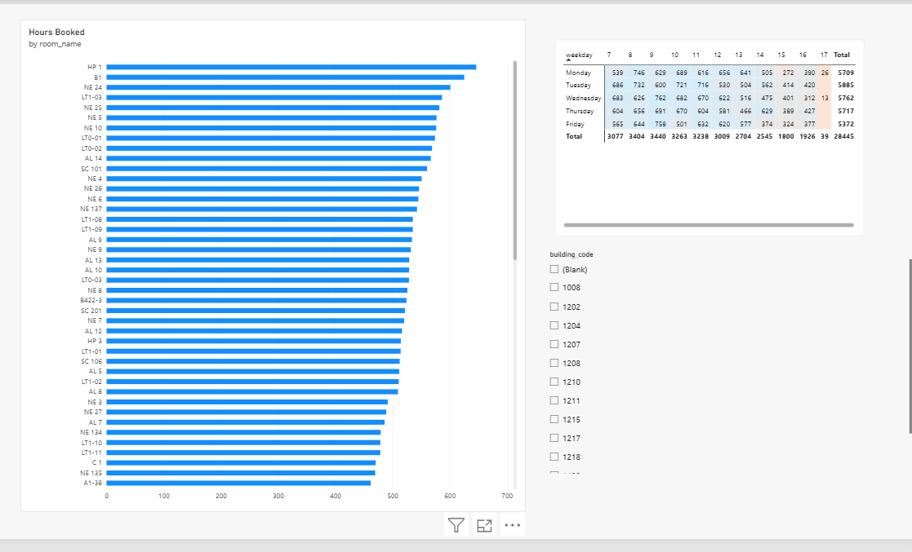
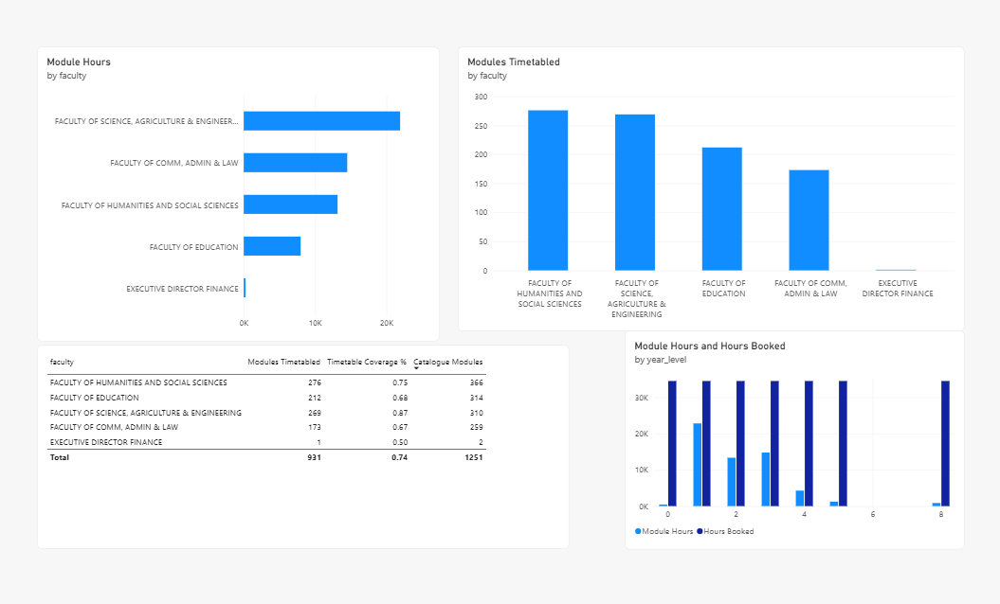

# CELCAT Timetable ELT Pipeline

An end-to-end data pipeline that extracts the University of Zululand's public CELCAT timetable, loads it into MySQL, models it for analysis, and visualises room and module usage in Power BI.

> **Data snapshot:** Semester 2, 2026 (extracted 8 October 2026).
> This project uses publicly available timetable data and is not affiliated with the university.

## Highlights

- Extracts **1,251 modules** and a timetable file for each one from CELCAT's public XML feeds.
- **ELT design:** raw data is loaded untouched into `tt_raw`, then cleaned and modelled with SQL in `tt`. A cleaning bug is fixed by re-running SQL, with no need to re-download anything.
- Turns weekly recurring patterns (day, time, and a 52-character Y/N week string) into **dated rows** with a week calendar.
- Handles real-world data problems: shared classes, multi-room classes, inconsistent module codes, placeholder strings, and a partial-download bug caught by validation.
- Two-page **Power BI dashboard** for room utilisation and module/faculty coverage, plus **data-backed recommendations** for the timetabling office.

## Architecture



| Layer | Where | What it holds |
|---|---|---|
| Raw files | `data/raw/` | Untouched module list (JSON) and per-module XML, one folder per extract run |
| Clean CSVs | `data/clean/` | Flattened `modules.csv`, `events.csv`, `event_resources.csv` |
| Raw tables | MySQL `tt_raw` | CSVs loaded as plain text, no cleaning |
| Clean model | MySQL `tt` | Typed tables, junction tables, week calendar, reporting views |

## Tech stack

Python 3.12 (`requests`, `pymysql`, `python-dotenv`, `xml.etree`), MySQL 8.0, SQL (recursive CTEs, views), Power BI Desktop, Git.

## Data source

CELCAT Web Publisher exposes public, unauthenticated XML:

- `finder.xml` lists every module (id, code, title, department, faculty).
- `m{id}.xml` holds one module's timetable.

The extractor waits 0.2 seconds between requests to stay polite to the university's server.

**Events have no calendar dates.** Each event is a weekly pattern: a day index (0 = Monday), start and end time, and a 52-character string with one Y/N per academic week. The XML header says week 1 starts on **Monday 2026-07-06** (all 1,251 files agree), and the teaching weeks are 1-7 and 9-14, with week 8 as recess. The pipeline uses that to expand each pattern into real dates.

## Data model



| Table / view | Grain |
|---|---|
| `modules` | One row per CELCAT module entry, with parsed base code, section, period, year level and faculty |
| `venues` | One row per room, with building, room name, venue type and capacity parsed from CELCAT's room label |
| `classes` | One row per CELCAT event, stored as a weekly pattern |
| `class_modules` | Many-to-many: one shared class can be listed under several modules |
| `class_venues` | Many-to-many: some classes use several rooms, some have none |
| `weeks` | Week number to the Monday date of that week |
| `class_occurrences` (view) | One row per class per active week, with a real date and duration in minutes |
| `fact_room_bookings` (view) | Reporting view: each booking joined to its room |
| `fact_module_sessions` (view) | Reporting view: each session joined to its module and faculty |

## Project structure

```
celcat-timetable-pipeline/
├── SQL/
│   ├── schema_mysql.sql        # databases, tables, week calendar, views
│   └── transform.sql           # tt_raw -> tt cleaning and modelling
├── timetable_pipeline.py       # extract module list from finder.xml
├── transform_modules.py        # flatten and clean modules -> modules.csv
├── extract_event.py            # download every module's timetable XML
├── parse_events.py             # flatten XML -> events.csv, event_resources.csv
├── load_raw.py                 # load CSVs into MySQL tt_raw
├── profile_modules.py          # profiling and validation helpers
├── check_weeks.py
├── check_pipeline.py
├── check_one_module.py
├── inspect_events.py
├── docs/                       # dashboard screenshots
├── requirements.txt
├── .env.example
└── .gitignore
```

## Getting started

**Requirements:** Python 3.12, MySQL 8.0 or newer (the week calendar uses a recursive CTE), and optionally Power BI Desktop with MySQL Connector/NET installed.

```bash
git clone https://github.com/Fanelesibongemanzini0-byte/celcat-timetable-pipeline.git
cd celcat-timetable-pipeline
python -m venv .venv
.venv\Scripts\activate
pip install -r requirements.txt
copy .env.example .env
```

Edit `.env` and enter your MySQL username and password. This file is git-ignored and never uploaded.

Create the databases by running `SQL/schema_mysql.sql` in MySQL Workbench with an admin account. Then make sure your pipeline user can write to both databases:

```sql
GRANT ALL PRIVILEGES ON tt_raw.* TO 'your_user'@'localhost';
GRANT ALL PRIVILEGES ON tt.*     TO 'your_user'@'localhost';
```

## Running the pipeline

Run these in order from the project folder:

| # | Step | Command | Output |
|---|---|---|---|
| 1 | Extract module list | `python timetable_pipeline.py` | `data/raw/modules/modules_<timestamp>.json` |
| 2 | Clean modules | `python transform_modules.py` | `data/clean/modules.csv` |
| 3 | Extract timetables | `python extract_event.py` | `data/raw/events/<timestamp>/m<id>.xml` |
| 4 | Flatten events | `python parse_events.py` | `data/clean/events.csv`, `event_resources.csv` |
| 5 | Load raw | `python load_raw.py` | MySQL `tt_raw` tables |
| 6 | Transform | run `SQL/transform.sql` in MySQL Workbench | MySQL `tt` tables |

In step 3, set `LIMIT = None` in the script for a full run. It takes about 6 minutes for all 1,251 modules. The default limit is a small test run.

**Expected row counts for the 8 October 2026 snapshot:**

- `tt_raw.modules`: 1,251
- `tt_raw.events`: 3,667
- `tt_raw.event_resources`: 10,208
- Distinct classes in `tt.classes`: 2,350

## Data cleaning process

Cleaning happens in stages, and the raw data is never changed along the way. If a rule turns out to be wrong, fix it and re-run from that stage.

**1. Extract (no cleaning).** The module list and every module's XML are saved exactly as CELCAT serves them, in a timestamped folder under `data/raw/`.

**2. Flatten (Python, light cleaning).** `transform_modules.py` and `parse_events.py` turn the raw files into CSVs:

- Split each module name into code and title, and keep the original text in `raw_name`.
- Break each module code into `base_code`, `section` and `period`, and set aside any trailing note (for example `-NURSING SCIENCE`).
- Derive `year_level` from the first digit of the 3-digit number in the code, and record which code scheme the module uses (digit or letter prefix).
- Convert placeholder values (`"[None]"` and empty text) to empty cells.
- Fill missing faculty from the most common faculty for that code prefix, and flag those rows with `faculty_derived`.
- Keep every room and module listed on an event, not just the first one, as separate rows in `event_resources.csv`.

**3. Load raw (no cleaning).** `load_raw.py` copies the CSVs into `tt_raw` as plain text. Empty cells become `NULL`.

**4. Transform (SQL).** `SQL/transform.sql` builds the typed `tt` tables from `tt_raw`. It clears and rebuilds them each time, so re-running gives the same result:

- Cast text to proper types (numbers, `TIME`, boolean).
- Collapse repeated events into one row per CELCAT event id, because the same event appears in every module file it belongs to.
- Parse each room label, such as `1217_2_AL 12 (LECTURE THEATER  [Capacity: 75])`, into venue code, building code, room name, venue type and capacity.
- Link classes to modules and venues through junction tables, matching on the module code and room code in each event's labels.
- Expand each weekly pattern into dated rows through the `weeks` table and the `class_occurrences` view.

**5. Validate.** After a load, compare row counts with the expected figures, run `check_pipeline.py` (XML files that contain events versus modules in `events.csv`), confirm the week-1 date across all files with `check_weeks.py`, and run the double-booking check.

Not yet cleaned: a few rooms are stored as two venues and some venue codes have no building code (see Limitations).

## Data quality and validation

Real-world issues found while profiling the data, and how each one is handled:

- **Module codes carry suffixes.** `1ANT112_01_2` is split into a base code, a section (`01`) and a period code (`2`). Year level comes from the first digit of the 3-digit number, not the leading character. The raw code is always kept.
- **Placeholder strings.** `"[None]"` appears as literal text in faculty and department. It becomes `NULL`.
- **Missing faculty.** About 15% of modules have no faculty. Because the code prefix maps to a faculty, missing values are filled from it and flagged with `faculty_derived`, so reports can exclude them.
- **Shared classes.** One class is often listed under several modules, so classes link to modules through a junction table. `event_id` is used as a global key after checking that events appearing in several files have identical times.
- **Multi-room and room-less classes.** Handled with a junction table to venues. Room-less classes are left out of room analysis.
- **Completeness check.** The first load ran against a partially downloaded folder and silently dropped about two-thirds of the classes. `check_pipeline.py` now compares the XML files that contain events with the modules in `events.csv`, and the check should report zero missing modules before loading. Only parse an extract that has finished.
- **Double-booking check.** A self-join on room, date and time overlap found no overlapping bookings in any room.

## Dashboard

The Power BI file connects to the `tt` database (Import mode). It isn't stored in this repository, because it is a binary file that can be rebuilt. To rebuild it: Get data → MySQL database → server `localhost`, database `tt`, then load `fact_room_bookings`, `fact_module_sessions`, `venues`, `modules` and `weeks`.

Relationships (one-to-many, dimension to fact):

- `venues[venue_id]` to `fact_room_bookings[venue_id]`
- `modules[module_id]` to `fact_module_sessions[module_id]`
- `weeks[week_no]` to `week_no` in both fact views

**Page 1: Room Bookings.** Hours booked per room, a weekday-by-hour heatmap of sessions, and a building slicer.



**Page 2: Modules.** Teaching hours by faculty, modules timetabled by faculty, hours by year level, and a coverage table.



DAX measures:

```
Hours Booked = SUM(fact_room_bookings[duration_min]) / 60
Room Sessions = COUNTROWS(fact_room_bookings)
Avg Capacity = AVERAGE(fact_room_bookings[capacity])
Module Hours = SUM(fact_module_sessions[duration_min]) / 60
Modules Timetabled = DISTINCTCOUNT(fact_module_sessions[module_id])
Catalogue Modules = COUNTROWS(modules)
Timetable Coverage % = DIVIDE([Modules Timetabled], [Catalogue Modules])
```

A shared class counts once for each module it serves, so `Module Hours` overstates room time. Use `Hours Booked` for anything about rooms.

## Key findings

- **931 of 1,251 modules (74%)** have classes published in CELCAT. Coverage by faculty: Science, Agriculture & Engineering 87% (269 of 310), Humanities & Social Sciences 75% (276 of 366), Education 68% (212 of 314), Commerce, Admin & Law 67% (173 of 259).
- **320 modules (26%) have no published timetable.** The gap is largest in Commerce, Admin & Law (86 of 259 modules, 33%) and Education (102 of 314, 32%), and smallest in Science (41 of 310, 13%).
- **HP1 is the most booked room** of the term.
- **No room is double-booked** anywhere in the timetable.
- **First-year modules carry the most timetabled hours**, followed by second and third year.
- **Three large lecture venues are lightly booked:** K 311 (108 seats, 21.7 hours), HA 3 (60 seats, 36.8 hours) and G 1 (90 seats, 41.7 hours).

## Recommendations

### 1. Check the unpublished modules

- **Finding:** 320 of 1,251 modules (26%) have no published timetable. The gap is largest in Commerce, Admin & Law (86 of 259 modules, 33%) and Education (102 of 314, 32%). In Science it is 41 of 310 (13%).
- **Recommendation:** Ask the Commerce and Education timetable coordinators to check the unpublished modules. Some are probably legitimately unscheduled (research or online modules) and others may simply be missing from CELCAT.
- **Caveat:** The data can't tell us which unpublished modules should have classes.

### 2. Offer the lightly used lecture venues as overflow space

- **Finding:** Three large lecture venues are booked for very few hours this semester: K 311 (108 seats, 21.7 hours), HA 3 (60 seats, 36.8 hours) and G 1 (90 seats, 41.7 hours).
- **Recommendation:** Ask the timetabling office whether these rooms are available, and if so offer them as overflow venues for large classes.
- **Caveat:** Bookings come from published timetables only (74% of modules). The rooms may be reserved, out of service, or far from the departments that need them.

## Limitations

- This is a snapshot of one semester. CELCAT is likely to replace it when the next term is published, so the raw folders are the only record of this one.
- 320 modules (26%) have no published timetable, so the dashboard shows scheduled teaching, not all teaching.
- The feed has no lecturer data, so staff workload can't be analysed.
- There is no attendance data. "Booked hours" measures how long rooms are reserved, not how full they are.
- Some rooms appear to be stored as more than one venue (for example PHYSICS LAB), and a few venue codes in a different format have no building code, so those rooms' hours may be split. Rooms that CELCAT never schedules don't appear in the data at all, so completely idle rooms can't be found.
- Event category codes (`C`, `T`, `P`, `SB`) are kept as published. The faculty-prefix mapping and the meaning of the building and level parts of room codes are inferred from patterns in the data, not from documentation.

## Roadmap

- Fix the venue parsing so each room is one record with a building code.
- Schedule the extract and load (Windows Task Scheduler first, Airflow later).
- Support several terms by adding a term column and keeping each snapshot.
- Move the SQL transforms into dbt, with automated tests for row counts and key uniqueness.
- Load incrementally instead of truncating the raw tables on every run.

## Related project

The scraping approach grew out of my [Unizulu Timetable Generator](https://github.com/Fanelesibongemanzini0-byte/Unizulu-timetable-generator), a Django app that builds personalised timetables from the same CELCAT data.

## Author

Fanele · GitHub: [@Fanelesibongemanzini0-byte](https://github.com/Fanelesibongemanzini0-byte)
